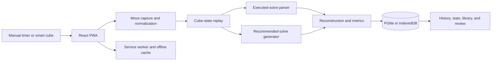

# Architecture

JBLD is a static, local-first PWA. The browser owns the timer, cube state, parser, recommender, algorithm library, and data store. The production workflow deploys only this browser application to GitHub Pages.

## System view



The older Python API, PostgreSQL deployment, Supabase prototype, and desktop BLE bridge are outside this runtime. Their status is recorded in [Legacy and experimental components](LEGACY.md).

## Frontend composition

[`website/src/App.jsx`](../website/src/App.jsx) coordinates the application lifecycle and views. Smaller components handle the timer, scramble display, connection controls, and settings. Domain logic lives in `src/utils/`, allowing cube analysis, notation, persistence, and imports to be tested without rendering the complete UI.

The principal views are:

- **Solve:** scramble, timer, cube connection, and last-solve summary;
- **History / Stats / Sessions:** saved solves and aggregate performance;
- **Practice:** targeted blind-solving practice sessions;
- **Drill / Alg Review:** smart-cube execution against saved algorithms and last-seen review queues;
- **Alg Library:** searchable and editable corners, edges, parity, twists, and flips;
- **Solve details:** reconstruction, per-comm timing, DNF notes, library matches, and recommended solve.

## Move capture and normalization

Smart-cube adapters append moves and timestamps to the same arrays used by the timer. [`extractRecordedSolve.js`](../website/src/utils/extractRecordedSolve.js) separates scramble activity from post-start solve moves.

[`normalizeForOrientation`](../website/src/utils/localCommParser.js) converts the configured cube orientation to a common reference frame. It keeps separate representations where needed:

- physical move tokens for commutator boundaries and display;
- normalized tokens for cube-state replay;
- opposite-face pairs converted to slice notation when appropriate;
- explicit wide moves preserved without leaking rotations into later moves.

This lets the parser compare states consistently while the reconstruction still matches what the solver turned.

## Executed-solve parser

[`localCommParser.js`](../website/src/utils/localCommParser.js) uses the 3x3 `KPuzzle` model from `cubing.js`.

### 1. Replay the solve

The scramble is applied first. The parser then applies every solve move and stores a snapshot after each move. Each state becomes a map from sticker slots to the stickers occupying them.

### 2. Search for a boundary

Starting from the previous accepted state, the parser evaluates progressively larger move windows. For each candidate endpoint it computes the changed stickers and groups them into physical edge and corner pieces.

A segment is accepted only when the state change has the shape of a supported case and the move span is plausible. This is more reliable than splitting only on pauses or similarity peaks, which can occur in the middle of an algorithm.

### 3. Classify the change

The parser recognizes:

- buffer-led three-piece cycles;
- buffer pseudo-solved cases;
- clean floating corner cycles;
- edge flips and corner twists from orientation-only states;
- mixed two-edge/two-corner parity states;
- three-corner twists produced by two consecutive commutators.

The two-comm twist check compares physical pieces, not just display letters. It combines the windows only when both involve the same three corners and the final permutation is solved with orientation remaining.

### 4. Handle cube rotations

Candidate states are also checked under valid cube orientations. If a segment is correct up to an implicit rotation, the parser records that rotation so the displayed algorithm and cube state stay aligned.

### 5. Emit structured data

Each commutator record contains its phase, targets, special-case type, algorithm, move range, parse text, and optional implicit rotation. [`localSolveParser.js`](../website/src/utils/localSolveParser.js) joins those records to move timestamps to calculate recognition and execution time.

Unknown move tails are retained as explicit unknown records rather than silently dropped. That matters when reviewing a DNF.

## Recommended solve

[`solveRecommender.js`](../website/src/utils/solveRecommender.js) uses the scramble and solver settings; it does not infer the recommendation from the recorded execution.

For edges and corners independently it:

1. builds a sticker-slot map from the scrambled cube;
2. follows the configured buffer to the next unsolved target;
3. swaps complete pieces in a working map after each target;
4. selects a new cycle break when the buffer cycle closes before every piece is solved;
5. accepts a user override when a different valid cycle break was used;
6. identifies pieces whose permutation is solved but orientation is not;
7. accounts for parity and groups the remaining targets into pairs.

The returned model includes target details and the valid alternatives for each cycle break. The solve-details view highlights those breaks and rebuilds the remaining recommendation after a selection changes.

## Persistence

[`localDatabase.js`](../website/src/utils/localDatabase.js) runs PostgreSQL-compatible PGlite in the browser and stores its files in IndexedDB. Migrations create normalized tables for:

- application metadata;
- sessions and solves;
- canonical commutator cases;
- commutators executed in each solve;
- algorithm-library entries and last-seen dates;
- complete practice-attempt records, including practice type, reconstruction, move timings, and DNF notes.

Existing `localStorage` data is migrated into PGlite. Small settings and compact recovery caches remain in `localStorage`, while larger solve history lives in the database.

This browser database is the current source of truth. Clearing the application's site data removes it, so cross-device movement relies on the application's import and export tools.

Existing practice history is migrated from `localStorage` on first startup. The browser database retains the complete history; the smaller recovery cache does not limit it. Pending practice saves keep a separate recovery snapshot until the database commits them. Backup version 3 exports and restores practice history alongside sessions, settings, and the algorithm library. Restoring an older backup preserves existing practice history; an explicit empty practice list clears it.

Session statistics use the complete loaded history, including after the `localStorage` session cache is compacted. Ao5, Ao12, and Ao50 use the latest 5, 12, and 50 attempts respectively, including DNFs, and trim 5% at each end rounded up. A DNF remaining after trimming makes the average DNF. Session and practice means and memo/execution averages use successful attempts with finite values. Practice uses the same average calculations as normal sessions.

## Algorithm library and review

Algorithm source sheets live as CSV files in [`website/src/data/`](../website/src/data/). A generated JavaScript seed makes the default library available offline.

The library pipeline:

- imports header-based or compact CSV files and multi-sheet workbooks;
- normalizes case names, memo words, categories, notes, and alternate algorithms;
- expands commutator and repeated-group notation;
- stores editable entries in PGlite;
- exports the current library as a workbook grouped by case type;
- updates `last_seen_at` when a case appears in a solve or practice session.

Alg Review creates queues weighted towards older entries. Smart-cube moves are compared with the selected algorithm after accounting for cube orientation, commuting turns, slice pairs, and equivalent wide moves.

## Smart-cube input

Bluetooth handling is part of the React application. It includes direct GAN support through `gan-web-bluetooth` and adapters derived from csTimer for other device families. Web Bluetooth requires a compatible browser and a secure context; Chromium-based browsers provide the most reliable path.

The checked-in [`bridge/`](../bridge/) process is not used by the application. It is an unfinished experiment for reading GAN BLE notifications through a native backend and rebroadcasting moves over a local WebSocket.

## PWA and deployment

[`website/src/service-worker.js`](../website/src/service-worker.js) caches the application shell, static assets, and selected images. It is registered in production builds, not by the development server.

The workflow in [`.github/workflows/deploy-pages.yml`](../.github/workflows/deploy-pages.yml):

1. installs `website/` dependencies with Node 22 and `npm ci --legacy-peer-deps`;
2. builds with `NODE_OPTIONS=--openssl-legacy-provider` because Create React App 4 uses Webpack 4;
3. uploads `website/build/` as a Pages artifact;
4. deploys that artifact to GitHub Pages.

There is no server process in this deployment. Requests to the old API are not part of the production data path, and the production environment does not provide Supabase credentials.

## Repository map

```text
JBLD/
|-- website/       Current React PWA, browser parser, data, and tests
|-- docs/          Concepts, architecture, development, and status notes
|-- .github/       Current GitHub Pages workflow
|-- server/        Legacy Flask API and Python parser
|-- database/      Legacy PostgreSQL initialization
|-- nginx/         Legacy reverse-proxy configuration
|-- bridge/        Incomplete BLE-to-WebSocket experiment
`-- docker-compose.yml  Legacy full-stack topology
```
